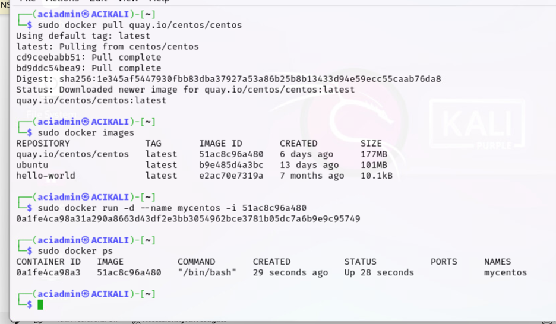
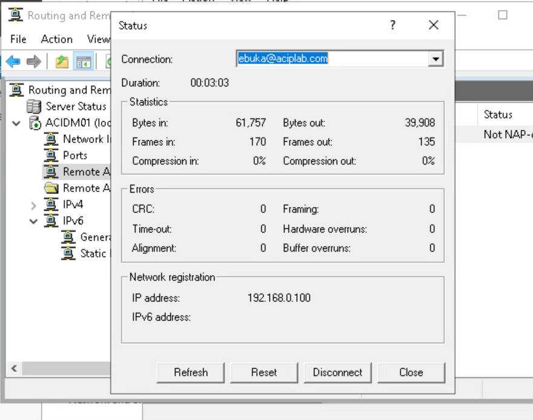
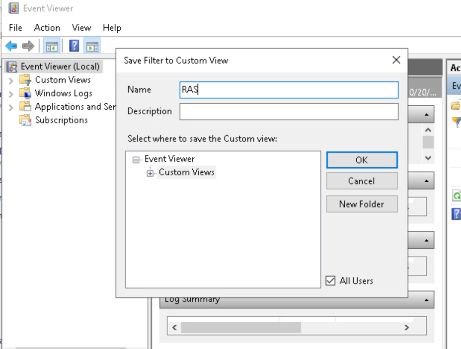
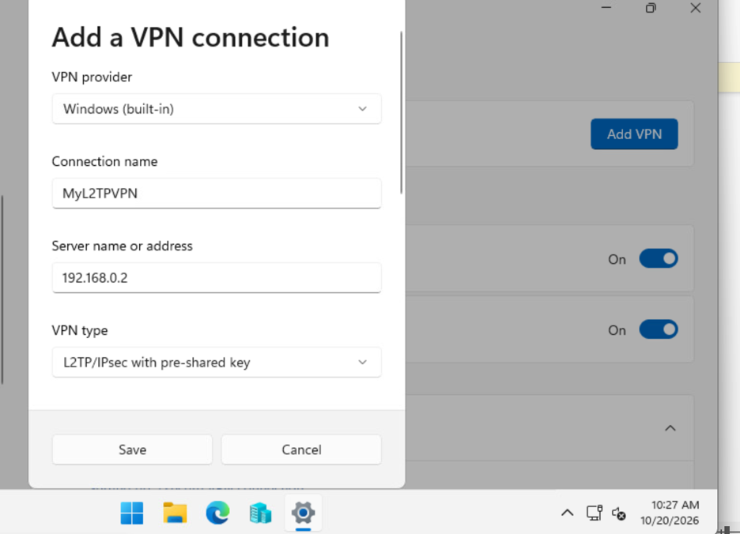

# Security Architecture & Enterprise Infrastructure

**Training:** CompTIA Security+ (SY0-701) Practical Labs  
**Focus:** Containerisation, secure remote access, identity management and monitoring.

## 1. Virtualisation & Containerisation

**Tools:** Docker, Kali Linux, Ubuntu, Portainer

- Pulled and executed Docker images using the command line.
- Launched an interactive Ubuntu container and verified shell access.
- Created a named CentOS container and confirmed its running status using `docker ps`.
- Deployed Portainer Community Edition and accessed its web-based setup interface.

## 2. Securing Enterprise Infrastructure

**Tools:** Windows Server 2022, Active Directory, RRAS, Windows 11, Windows Defender Firewall, Event Viewer

- Installed and configured Routing and Remote Access (RRAS) for VPN access.
- Created a VPN user account in Active Directory.
- Configured remote access firewall permissions and an Event Viewer custom view.
- Established and verified an authenticated VPN connection, confirming the assigned client IP address and active traffic.
- Configured L2TP/IPsec VPN settings using a pre-shared key; the separate L2TP/IPsec connection was not successfully established.

## Key Learning

- Developed practical experience with Docker image and container management.
- Explored enterprise VPN deployment, Active Directory authentication and remote access monitoring.
- Troubleshot Portainer access and reached its setup interface, but did not complete GUI-based container management.
- Gained an understanding of the importance of validating security configurations rather than assuming they work.

## Evidence

Screenshots below demonstrate selected configuration and verification results from the completed exercises.

### Docker Container Management

### VPN Connection Verification

### VPN Event Monitoring

### L2TP/IPsec Configuration

> These exercises were completed in a guided training environment. The documentation reflects my practical work and observed results.
  
