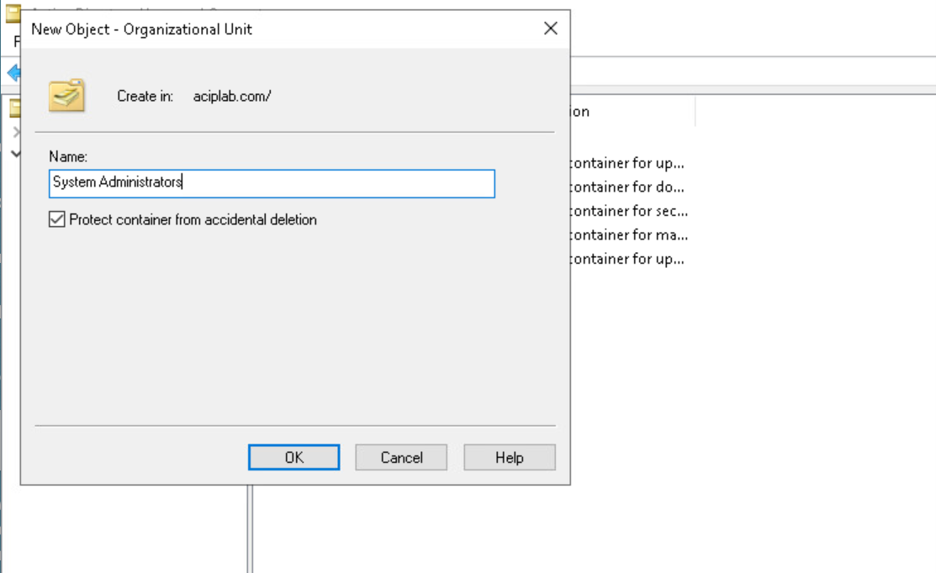
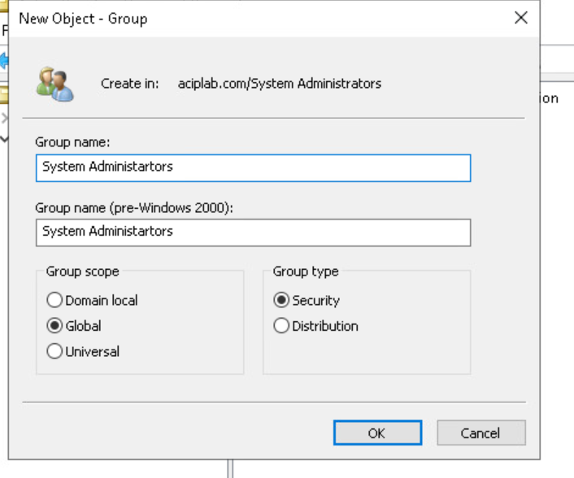
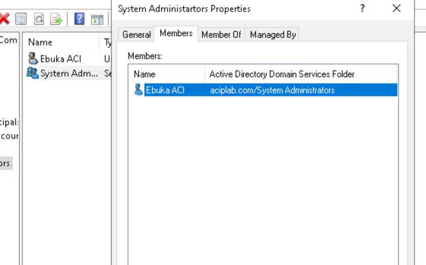
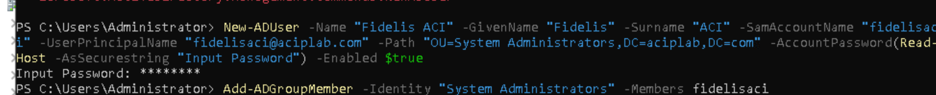
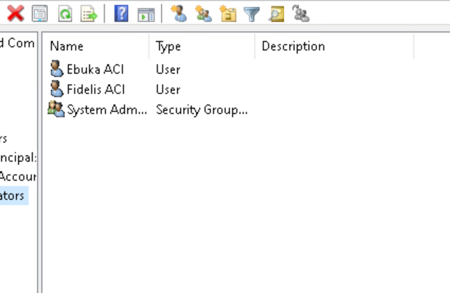
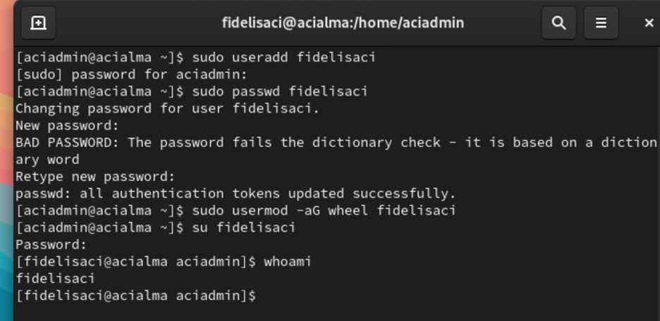

# Identity & Access Management (IAM) — Windows & Linux

**CompTIA Security+ | Hands-On Practical Lab**

## Project at a Glance

Practised Identity and Access Management (IAM) across **Windows Active Directory and Linux** by provisioning user accounts, configuring security groups, and verifying user identities.

Used **Active Directory Users and Computers (ADUC), Windows PowerShell, and Linux terminal commands** to understand how identities are created and organised across different operating systems.

### Key Activities

- Created an Organisational Unit (OU) in Active Directory.
- Configured a Global Security Group and assigned a domain user.
- Provisioned an additional domain account using PowerShell.
- Added the new account to an Active Directory security group.
- Created a local Linux user and added it to the `wheel` group.
- Verified the Linux account using `whoami`.

**Skills Demonstrated:** Identity & Access Management | Active Directory | User Provisioning | Group-Based Access Control | PowerShell | Linux Administration

**Tools:** `Windows Server` `Active Directory` `PowerShell` `Linux` `Bash`

---

## 1. Active Directory — Organisational Unit

### Objective

Organise domain accounts and groups within a dedicated Active Directory Organisational Unit.

### Implementation

Using Active Directory Users and Computers, I created an OU named **System Administrators** within the `aciplab.com` domain.

I enabled **Protect container from accidental deletion** to reduce the risk of unintended removal.



**Security relevance:** Organisational Units support structured directory administration, Group Policy application, and administrative delegation.

An OU organises directory objects but does not itself grant administrative privileges.

---

## 2. Active Directory — Security Group & Membership

### Objective

Practise group-based access management by creating a security group and assigning a domain user.

### Implementation

Created the following group inside the System Administrators OU:

| Property | Configuration |
|---|---|
| Group name | System Administrators |
| Group scope | Global |
| Group type | Security |
| Domain | aciplab.com |



I then added the existing domain user **Ebuka ACI** to the group and reviewed the membership through Active Directory Users and Computers.



**Security relevance:** Security groups simplify access management by allowing permissions to be assigned to groups instead of individual accounts.

Group membership should follow the **principle of least privilege**. Creating a group called System Administrators does not automatically provide administrative permissions.

---

## 3. PowerShell — Active Directory User Provisioning

### Objective

Explore command-line identity provisioning as an alternative to graphical administration.

### Implementation

Used Windows PowerShell to create an additional domain user, **Fidelis ACI**, within the System Administrators OU.

The provisioning process used:

- `New-ADUser` to create and enable the account.
- `Read-Host -AsSecureString` to obtain the initial password without displaying it.
- `Add-ADGroupMember` to add the account to the security group.

**Key commands:**

```powershell
New-ADUser
Add-ADGroupMember
```



After running the commands, I reviewed the Active Directory console, which displayed both user accounts and the security group.



**Security relevance:** PowerShell supports repeatable account provisioning and can help administrators standardise identity management tasks.

The directory view provides evidence of the created account; group membership should also be verified separately when validating access.

---

## 4. Linux — User Provisioning & Group Management

### Objective

Create a Linux user, configure group membership, and verify the account identity.

### Implementation

Created a local user:

```bash
sudo useradd fidelisaci
```

Set the user's password:

```bash
sudo passwd fidelisaci
```

Added the user to the `wheel` group:

```bash
sudo usermod -aG wheel fidelisaci
```

Switched to the new account and verified the active identity:

```bash
su fidelisaci
whoami
```

**Result:** The terminal returned `fidelisaci`, confirming that the session was running under the newly created user identity.



### Security Observations

The terminal displayed a dictionary-based password warning during password creation. This reinforced the importance of using strong, unique passwords.

The `wheel` group is commonly associated with administrative access on Linux, but actual privileges depend on the system's sudo configuration.

**Security relevance:** Linux account provisioning and group management are fundamental to controlling access to system resources and limiting unnecessary privileges.

---

## 5. Security Principles Demonstrated

| Principle | Practical Application |
|---|---|
| Identity provisioning | Created domain and local user accounts |
| Group-based access management | Assigned Active Directory and Linux group memberships |
| Least privilege | Considered the importance of limiting elevated access |
| Directory organisation | Used an OU to organise AD objects |
| Identity verification | Confirmed the active Linux user using `whoami` |
| Administrative consistency | Used PowerShell and Linux commands for account management |

**Scope:** This lab demonstrated account creation and group membership management. It did not include a full access-control audit or verification of effective administrative privileges.

---

## 6. Key Lessons Learned

1. **Windows and Linux use different identity management approaches.** Active Directory provides centralised domain administration, while this Linux exercise focused on local user accounts.

2. **Security groups make access administration more manageable.** Group membership can support role-based permissions when appropriate access rights are configured.

3. **PowerShell improves administrative flexibility.** User provisioning can be performed through commands rather than relying exclusively on graphical tools.

4. **Account creation is not the same as access validation.** Effective permissions, group memberships, and authentication controls should be checked separately.

5. **Least privilege is essential.** Administrative access should only be granted where justified and should be regularly reviewed.

---

## Future Improvements

I plan to build on this exercise by exploring:

- Role-Based Access Control (RBAC)
- Group Policy and delegated administration
- Privileged access verification
- Account auditing and access reviews
- Automated onboarding and offboarding

These topics will support my continued development in enterprise systems administration and cybersecurity operations.

---

## Conclusion

This practical lab strengthened my understanding of user provisioning and group-based identity management across Windows and Linux environments.

It provided hands-on experience with Active Directory, PowerShell, and Linux account administration while reinforcing the importance of **least privilege, identity verification, and controlled access management**.

---

**Lab Scope:** All activities were performed in an authorised, controlled educational environment.
