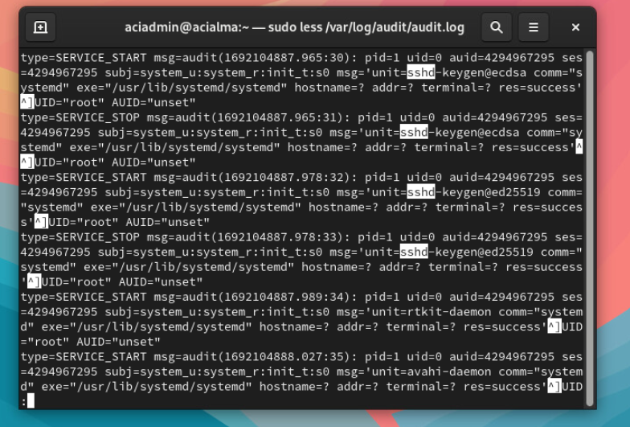
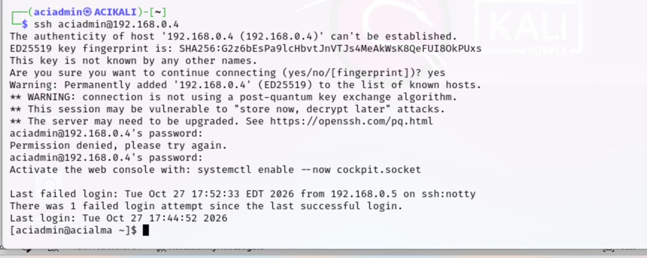
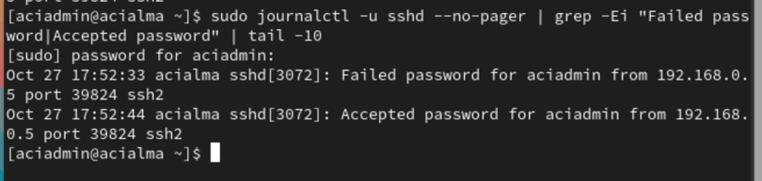
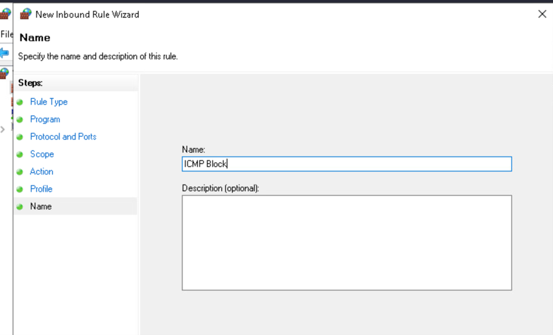
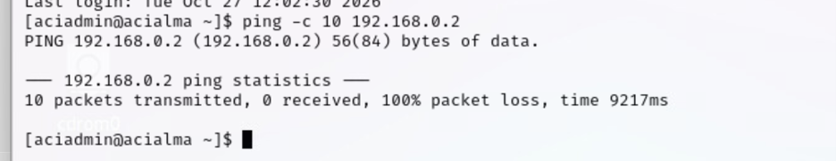
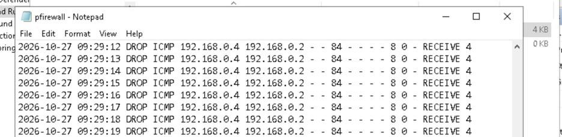

# Investigative Data Sources — Linux & Windows Security Log Analysis

**CompTIA Security+ | Hands-On Security Operations Lab**

## Project at a Glance

Investigated security-relevant events across Linux and Windows systems by generating controlled authentication and network activity, examining system logs, and correlating recorded events with observed behaviour.

The lab focused on two investigation scenarios:

1. **Linux SSH Authentication Analysis** — Generated failed and successful SSH login events from Kali Linux and investigated the corresponding authentication records on AlmaLinux.
2. **Windows Firewall Log Analysis** — Configured a Windows Firewall rule to block ICMP traffic, tested connectivity from Kali Linux, and examined firewall logs to identify dropped packets.

**Skills Demonstrated:** Security Log Analysis | Event Correlation | SSH Authentication Monitoring | Windows Firewall | Linux Administration | Network Troubleshooting | SOC Investigation Fundamentals

**Tools:** `AlmaLinux` `Kali Linux` `Windows` `journalctl` `auditd` `SSH` `Windows Defender Firewall` `PowerShell`

---

## 1. Lab Objectives

The objectives of this exercise were to:

- Locate and inspect security-related logs on Linux systems.
- Generate controlled SSH authentication events for investigation.
- Identify failed and successful authentication attempts.
- Examine Linux audit events.
- Configure a Windows Firewall rule to block ICMP traffic.
- Test the effectiveness of the rule using network connectivity checks.
- Analyse Windows Firewall logs to identify blocked traffic.
- Understand how system logs support security monitoring and incident investigations.

All activities were performed within an authorised educational lab environment.

---

## 2. Lab Environment

| System | Purpose |
|---|---|
| Kali Linux | Generated SSH authentication attempts and ICMP network traffic |
| AlmaLinux | SSH target and Linux log investigation |
| Windows | Firewall configuration, connectivity testing and log analysis |

### Network Details

| Host | IP Address |
|---|---|
| Kali Linux | 192.168.0.5 |
| AlmaLinux | 192.168.0.4 |
| Windows target | 192.168.0.2 |

The systems communicated within the controlled lab network.

---

## 3. Linux Security Log Investigation

### Objective

Understand how Linux records security-relevant system events and how those records can be inspected during an investigation.

### Implementation

On AlmaLinux, I inspected the audit log using:

```bash
sudo less /var/log/audit/audit.log
```

The audit records contained event information such as:

- Event type
- Timestamp
- Process ID
- User and audit identifiers
- Executed processes
- Result or success status


I also used the following command to monitor new audit events as they were written:

```bash
sudo tail -F /var/log/audit/audit.log
```



### Security Relevance

Linux audit records can provide useful evidence of system activity, including process execution and privileged operations.

Analysts can examine these records to investigate unexpected behaviour, support incident timelines, and understand activity occurring on a system.

---

## 4. SSH Authentication Investigation

### Objective

Generate and investigate authentication events to understand how failed and successful SSH login attempts are recorded.

### Implementation

From Kali Linux, I initiated an SSH connection to the AlmaLinux system:

```bash
ssh aciadmin@192.168.0.4
```

I deliberately entered an incorrect password before successfully authenticating with the correct credentials.



### Authentication Log Analysis

On AlmaLinux, I filtered the SSH service journal using:

```bash
sudo journalctl -u sshd --no-pager | grep -Ei "Failed password|Accepted password" | tail -10
```

The output showed two related authentication events.



### Investigation Findings

| Field | Observed Value |
|---|---|
| Target host | acialma |
| Source IP | 192.168.0.5 |
| Target account | aciadmin |
| Service | sshd |
| Source port | 39824 |
| Failed authentication | 17:52:33 |
| Successful authentication | 17:52:44 |
| SSH process ID | 3072 |

The logs showed a failed password attempt followed approximately 11 seconds later by a successful authentication.

Both events referenced the same source IP address, source port, account and SSH process ID, supporting their correlation to the same SSH connection.

### Security Analysis

In a real security operations environment, authentication records can help analysts identify:

- Repeated failed login attempts
- Unexpected successful logins
- Authentication activity from unfamiliar IP addresses
- Potential password guessing
- Unusual authentication patterns

**Important:** The events in this exercise were deliberately generated for testing. A single failed login followed by a successful login is not sufficient evidence of malicious activity.

Additional context would be needed before classifying similar activity as a security incident.

---

## 5. Windows Firewall Configuration

### Objective

Configure a Windows Firewall rule to block ICMP traffic and examine the resulting network behaviour.

### Implementation

Using Windows Defender Firewall with Advanced Security, I created an inbound rule named:

**ICMP Block**

The rule was configured to block incoming ICMPv4 traffic.



### Security Relevance

Host-based firewalls help control network communication by allowing or blocking traffic according to configured policies.

Firewall rules can reduce unnecessary network exposure and support network access restrictions.

---

## 6. ICMP Connectivity Testing

### Objective

Test the effect of the firewall rule from another system on the lab network.

### Implementation

From the Linux terminal, I attempted to ping the Windows target:

```bash
ping -c 10 192.168.0.2
```

### Observed Result

The connectivity test returned:

- **Packets transmitted:** 10
- **Packets received:** 0
- **Packet loss:** 100%



The result was consistent with the configured ICMP blocking rule.

However, packet loss alone does not prove that a firewall blocked the traffic. Firewall logs provide stronger evidence of the cause.

---

## 7. Windows Firewall Log Analysis

### Objective

Examine firewall logs to identify evidence of blocked ICMP packets.

### Implementation

After generating ICMP traffic, I inspected the Windows Firewall log.

The log contained entries with the following characteristics:

| Field | Observed Value |
|---|---|
| Action | DROP |
| Protocol | ICMP |
| Source IP | 192.168.0.4 |
| Destination IP | 192.168.0.2 |
| Packet size | 84 bytes |
| Direction | RECEIVE |



### Investigation Findings

The firewall recorded multiple incoming ICMP packets being dropped.

These entries provided evidence that the Windows host was blocking ICMP traffic, consistent with the configured rule and unsuccessful connectivity test.

**Observation:** The firewall log identifies `192.168.0.4` as the source IP, while the earlier SSH exercise used Kali at `192.168.0.5`. The firewall evidence therefore reflects traffic from `192.168.0.4`, and should not be described as originating from Kali without additional verification.

### Security Relevance

Windows Firewall logs can help security analysts:

- Identify blocked or permitted network traffic.
- Investigate connectivity failures.
- Verify the effects of firewall policies.
- Examine source and destination IP addresses.
- Correlate network events with system configuration changes.

---

## 8. Investigation Summary

| Scenario | Activity | Evidence | Finding |
|---|---|---|---|
| Linux audit inspection | Reviewed audit records | Audit log entries | Observed system activity |
| SSH authentication | Failed and successful login | SSH service journal | Both authentication events recorded |
| Firewall configuration | Blocked ICMPv4 | Windows Firewall rule | Blocking policy configured |
| Network testing | ICMP connectivity test | Ping output | 100% packet loss |
| Firewall investigation | Reviewed dropped traffic | Windows Firewall log | Incoming ICMP packets dropped |

### Key Security Concepts

**Event Correlation:** Comparing timestamps, source addresses, process identifiers and event types helps analysts connect related activity.

**Authentication Monitoring:** Login records provide evidence that can support investigation of suspicious access attempts.

**Firewall Visibility:** Firewall logs can help distinguish network connectivity failures from traffic deliberately blocked by security policy.

**Evidence-Based Investigation:** Security conclusions should be supported by relevant logs rather than assumptions based on a single observation.

---

## 9. Key Lessons Learned

1. **Linux provides multiple security data sources.** The audit log and SSH service journal record different types of activity useful for investigations.

2. **Authentication logs provide valuable context.** Source IP addresses, timestamps, account names and process identifiers can help correlate login events.

3. **Network failures require investigation.** Packet loss alone does not establish why traffic failed.

4. **Firewall logs strengthen findings.** Recorded DROP entries provide more direct evidence of firewall enforcement.

5. **Security events require interpretation.** An authentication failure is not automatically an attack, and analysts must consider the surrounding context.

---

## 10. Future Improvements

To extend this lab, I plan to explore:

- Centralised log collection using a SIEM
- SSH authentication monitoring and alerting
- Windows Event Viewer and security event IDs
- Firewall rule validation and change monitoring
- Timeline reconstruction across multiple log sources
- Detection rules for repeated authentication failures

These improvements would build on the foundational investigation skills demonstrated in this exercise.

---

## Conclusion

This practical lab developed my ability to investigate security-related activity across Linux and Windows systems.

By generating authentication and network events, examining relevant logs, and correlating findings with system behaviour, I gained hands-on experience with techniques used in security monitoring and incident investigation.

The exercise reinforced the importance of **accurate log interpretation, event correlation, and evidence-based security analysis**.

---

**Lab Scope:** Conducted in an authorised educational environment as part of CompTIA Security+ practical training.
