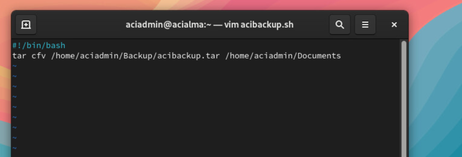
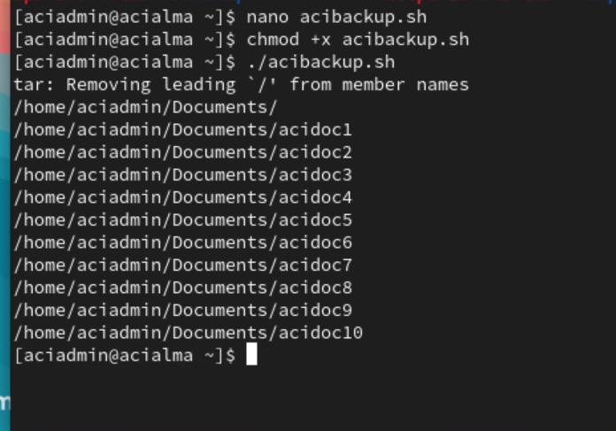
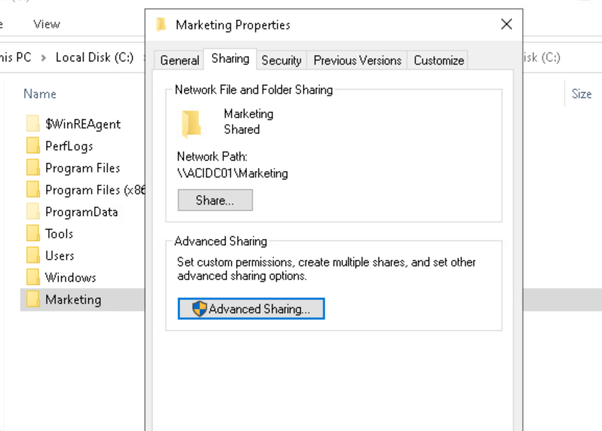
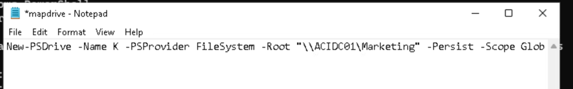
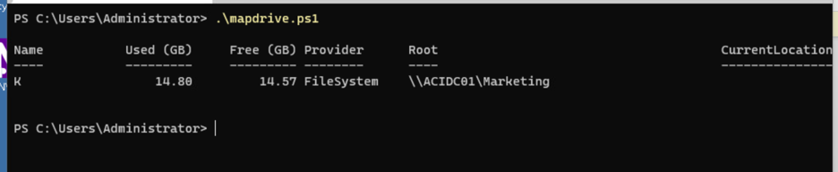
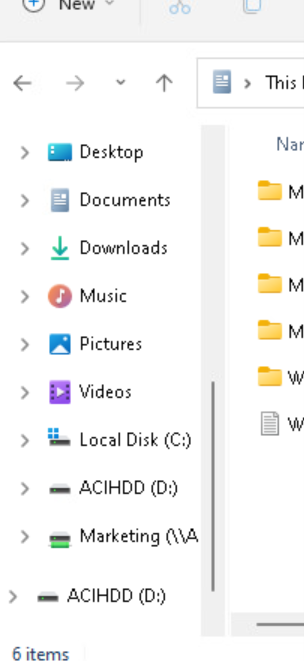

# Security Operations Automation Fundamentals — Bash & PowerShell

**CompTIA Security+ | Hands-On Automation Lab**

## Project at a Glance

Practised foundational automation techniques across Linux and Windows environments by creating and executing scripts for file backup and network resource access.

The lab focused on two practical activities:

1. **Linux Backup Automation** — Created a Bash script to archive documents using the `tar` utility.
2. **Windows PowerShell Automation** — Configured a shared network folder and used PowerShell to map the shared resource as a network drive.

These activities introduced scripting concepts relevant to repeatable system administration and security operations tasks.

**Skills Demonstrated:** Bash Scripting | PowerShell | Task Automation | File Backup | Network File Sharing | Windows Administration | Linux Administration

**Technologies:** `AlmaLinux` `Windows` `Bash` `PowerShell` `tar` `New-PSDrive`

---

## 1. Lab Objectives

The objectives were to:

- Create and execute a basic Bash script on Linux.
- Automate file archiving using the `tar` command.
- Apply executable permissions to a script.
- Configure a shared folder on Windows.
- Use PowerShell to map a network resource.
- Verify successful execution of automation commands.
- Understand how scripting can support repeatable administrative tasks.

All activities were completed within an authorised educational lab environment.

---

## 2. Linux — Backup Script Automation

### Objective

Create a Bash script that packages files from a source directory into a backup archive.

### Implementation

I prepared sample documents in the Linux environment and created a directory named `Backup` to store the resulting archive.

I then created a Bash script named `acibackup.sh`.

Although the lab instructions demonstrated the Vim editor, I used **Nano** to edit the script because I was more comfortable working with it.

The script contained:

```bash
#!/bin/bash
tar cfv /home/aciadmin/Backup/acibackup.tar /home/aciadmin/Documents
```



### Script Explanation

| Component | Purpose |
|---|---|
| `#!/bin/bash` | Specifies the Bash interpreter |
| `tar` | Creates or manages archive files |
| `c` | Creates a new archive |
| `f` | Specifies the archive filename |
| `v` | Displays processed files |
| `acibackup.tar` | Output archive |
| `/home/aciadmin/Documents` | Source directory |

The script creates a TAR archive containing the files in the Documents directory.

### Execution

I made the script executable using:

```bash
chmod +x acibackup.sh
```

Then executed it:

```bash
./acibackup.sh
```

The terminal displayed the files being processed, including the sample documents.



### Observed Result

The script executed and listed the source files being added to the archive.

This demonstrated a repeatable file archiving process that could be run without manually entering the full `tar` command each time.

**Security relevance:** Scripted backups can support data availability and recovery preparation. However, a production backup process would also require integrity checks, secure storage, retention controls and recovery testing.

---

## 3. Windows — Network Folder Sharing

### Objective

Configure a shared Windows folder that could be accessed through a network path.

### Implementation

I created a folder named `Marketing` and configured network sharing on the Windows system.

The shared folder was accessible through the following UNC path:

```text
\\ACIDC01\Marketing
```



### Security Relevance

Network file sharing supports centralised access to shared resources.

In production environments, access should be restricted using appropriate share and NTFS permissions, with access granted only to authorised users.

This exercise demonstrated the sharing configuration, rather than a full permissions audit.

---

## 4. PowerShell — Network Drive Mapping

### Objective

Use PowerShell to map the shared Windows folder as a network drive.

### Implementation

I prepared a PowerShell script named `mapdrive.ps1` using the `New-PSDrive` cmdlet.

The script used the following command:

```powershell
New-PSDrive -Name K -PSProvider FileSystem -Root "\\ACIDC01\Marketing" -Persist -Scope Global
```



### Command Explanation

| Parameter | Purpose |
|---|---|
| `-Name K` | Assigns the drive letter K |
| `-PSProvider FileSystem` | Uses the filesystem provider |
| `-Root` | Specifies the shared network path |
| `-Persist` | Requests a persistent Windows mapped drive |
| `-Scope Global` | Creates the PowerShell drive in the global scope |

### Execution and Verification

I executed the PowerShell script and reviewed the output.



The command returned a filesystem drive named `K` with the root path:

```text
\\ACIDC01\Marketing
```

I also checked File Explorer, where the Marketing network drive appeared.



### Observed Result

The shared folder was successfully mapped as drive `K`, demonstrating command-line access to a Windows network resource.

**Security relevance:** PowerShell can automate repetitive administrative operations, including network resource configuration. Access to shared resources should still be governed by appropriate authentication and permissions.

---

## 5. Automation and Security Operations

Automation helps reduce repetitive manual work and supports consistent execution of operational procedures.

| Activity | Potential Operational Benefit |
|---|---|
| Bash file archiving | Repeatable backup preparation |
| Script execution | Reduced need to re-enter commands |
| PowerShell drive mapping | Consistent network resource configuration |
| Network file sharing | Centralised access to shared resources |

### Relationship to SOAR

Security Orchestration, Automation and Response (SOAR) platforms can combine security alerts, integrations and automated response workflows.

This lab focused on **basic scripting and administrative automation**. It did not implement a SOAR platform, event-triggered playbook or automated incident response.

The scripting concepts practised here provide a foundation for learning more advanced security automation techniques.

---

## 6. Key Lessons Learned

1. **Bash can simplify repeatable Linux tasks.** A short script can package multiple files into an archive using a single command.

2. **PowerShell supports Windows administration.** The `New-PSDrive` cmdlet can be used to configure access to shared network resources.

3. **Verification matters.** Command output and File Explorer provided evidence that the network drive mapping was successful.

4. **Automation requires security controls.** Scripts should be tested, permissions restricted and sensitive data protected.

5. **Basic automation differs from SOAR.** Writing scripts is an important starting point, but full security orchestration involves additional integrations, triggers and response logic.

---

## 7. Future Improvements

Potential extensions include:

- Verify archive contents and test file restoration.
- Add error handling and logging to the Bash script.
- Schedule backups using cron or systemd timers.
- Validate network share availability before mapping.
- Add PowerShell error handling.
- Explore event-triggered security response workflows.

---

## Conclusion

This practical lab strengthened my understanding of foundational automation across Linux and Windows systems.

By creating a Bash backup script and using PowerShell to map a shared network drive, I gained experience with scripting, command execution and verification.

The exercise provided a starting point for developing more advanced automation skills relevant to IT administration and security operations.

---

**Lab Scope:** Completed in an authorised educational environment as part of CompTIA Security+ practical training.
