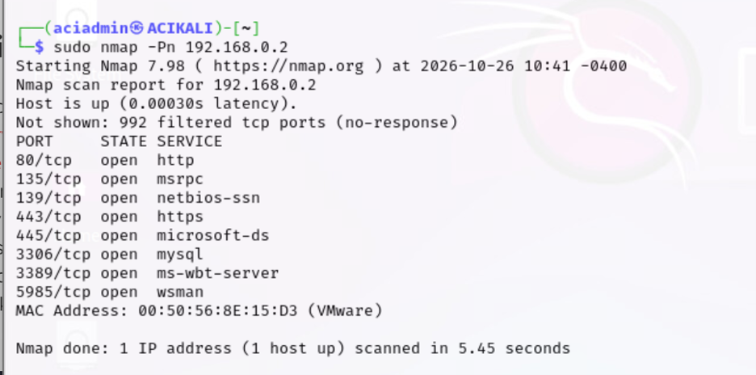
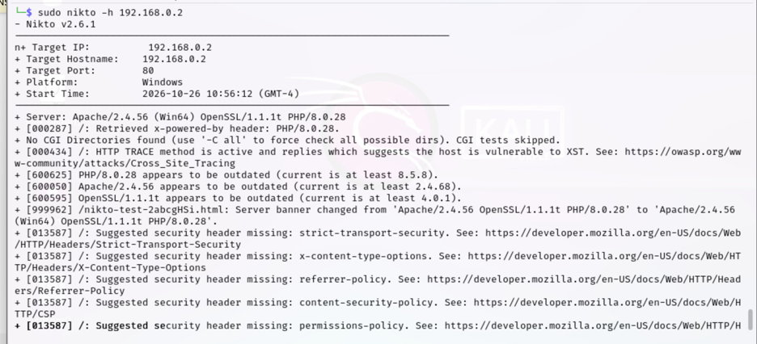
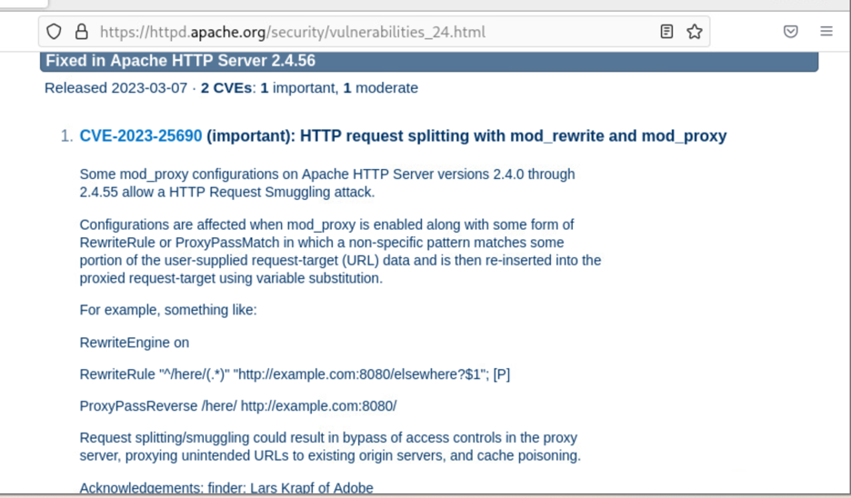
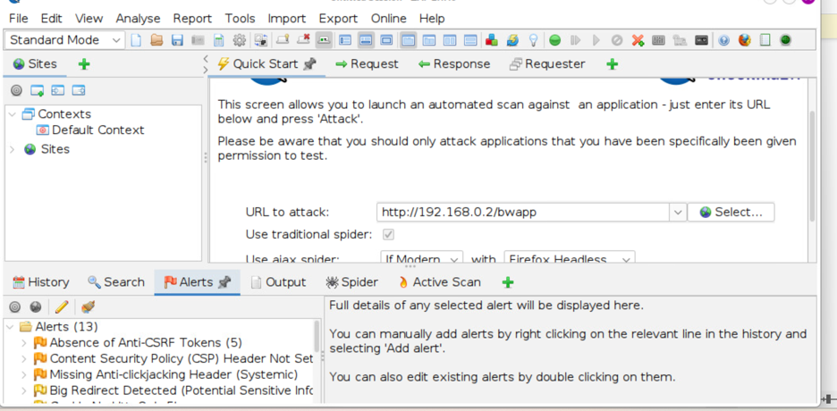
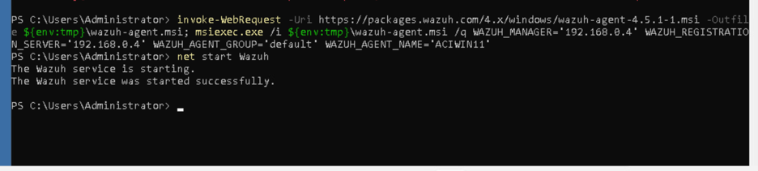
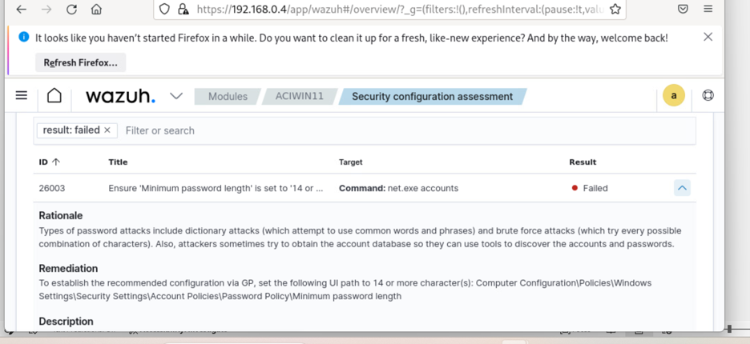

# Vulnerability Management & Endpoint Security Assessment

**CompTIA Security+ | Practical Cybersecurity Lab**

## Project at a Glance

Conducted a vulnerability assessment across network services, web applications, and a Windows endpoint in a controlled lab environment.

Using **Nmap, Nikto, OWASP ZAP, and Wazuh**, I identified exposed services, investigated potential security weaknesses, researched vendor advisories, and assessed Windows endpoint security configurations.

### Key Results

- Identified **8 open TCP ports** using Nmap.
- Detected potential web-server security weaknesses using Nikto.
- Investigated web application security alerts using OWASP ZAP.
- Researched Apache security advisories to evaluate scanner findings.
- Deployed a Windows Wazuh agent using PowerShell.
- Identified a failed Windows password-policy check using **Wazuh Security Configuration Assessment (SCA)**.

**Skills Demonstrated:** Vulnerability Assessment | Network Reconnaissance | Web Application Security | Endpoint Security | Security Analysis | Remediation Planning

**Tools:** `Nmap` `Nikto` `OWASP ZAP` `Wazuh` `PowerShell` `Kali Linux` `Windows`

---

## 1. Project Overview

Vulnerability management is an important part of maintaining secure systems. It involves identifying security weaknesses, assessing their potential impact, prioritising remediation, and verifying that appropriate fixes have been applied.

In this practical lab, I investigated potential vulnerabilities across network services, web applications, and a Windows endpoint.

I used multiple security tools to understand how different assessment techniques provide visibility into an organisation's attack surface.

One particularly interesting part of this project was returning to **Wazuh**, which I had previously used in my university SOC lab for threat detection and incident investigation.

This time, I explored another capability: **Security Configuration Assessment (SCA)**, which evaluates endpoint security settings against defined configuration checks.

### Lab Objectives

1. Discover exposed network services.
2. Identify potential web-server vulnerabilities.
3. Assess web application security controls.
4. Research relevant vendor security advisories.
5. Deploy a Windows monitoring agent.
6. Identify endpoint security configuration weaknesses.
7. Interpret findings and consider appropriate remediation.

---

## 2. Network Reconnaissance — Nmap

### Objective

Identify accessible TCP services on the target Windows system to understand its network exposure.

### Implementation

I performed a port scan using Nmap from Kali Linux.

**Command:**

```bash
sudo nmap -Pn 192.168.0.2
```

The `-Pn` option skips host discovery and proceeds with scanning.

### Findings

The scan identified eight open TCP ports.

| Port | Service |
|---|---|
| 80 | HTTP |
| 135 | Microsoft RPC |
| 139 | NetBIOS |
| 443 | HTTPS |
| 445 | SMB |
| 3306 | MySQL |
| 3389 | Remote Desktop Protocol |
| 5985 | Windows Remote Management |

**Evidence:**



### Security Analysis

The results demonstrated how network reconnaissance can identify accessible services and potential entry points.

Services such as SMB, RDP, MySQL, and WinRM require appropriate security controls, particularly when exposed beyond trusted networks.

An open port does not automatically indicate a vulnerability. However, unnecessary or insecurely configured services can increase a system's attack surface.

**Recommendation:** Review exposed services, disable unnecessary services, and restrict access through appropriate firewall and network controls.

---

## 3. Web Server Vulnerability Assessment — Nikto

### Objective

Identify potential web-server vulnerabilities, outdated software components, insecure HTTP methods, and missing security controls.

### Implementation

I used Nikto to assess the web service discovered during network reconnaissance.

**Command:**

```bash
sudo nikto -h 192.168.0.2
```

### Findings

Nikto reported several observations, including:

| Finding | Security Relevance |
|---|---|
| Apache HTTP Server 2.4.56 | Requires version and advisory review |
| PHP 8.0.28 | Software support and security updates should be reviewed |
| OpenSSL 1.1.1t | Requires support and vulnerability review |
| HTTP TRACE enabled | Potential unnecessary HTTP functionality |
| Missing security headers | Reduced browser-side security protections |

**Evidence:**



### Vulnerability Research

Following the scan, I researched Apache HTTP Server security advisories to understand how reported software versions relate to known vulnerabilities and vendor fixes.

I examined **CVE-2023-25690**, an HTTP request splitting vulnerability affecting certain Apache configurations.

**Evidence:**



The target was reported as running Apache 2.4.56, which includes the fix for CVE-2023-25690.

Therefore, this advisory was reviewed as part of vulnerability research rather than evidence that the target was affected by this specific CVE.

### Security Analysis

This exercise highlighted the importance of validating automated scanner findings.

Identifying a software version is only the beginning of vulnerability assessment. Analysts must also consider:

- Affected software versions
- Vendor security advisories
- Configuration requirements
- Available patches and mitigations
- Actual system exposure

**Recommendation:** Maintain supported software versions, disable unnecessary HTTP methods, review missing security headers, and validate potential vulnerabilities against vendor documentation.

---

## 4. Web Application Security Assessment — OWASP ZAP

### Objective

Assess the web application for potential security weaknesses that may not be identified through network or web-server scanning alone.

### Implementation

I used OWASP ZAP to assess the deliberately vulnerable web application hosted at:

```text
http://192.168.0.2/bwapp
```

### Findings

The assessment generated security alerts including:

- Absence of anti-CSRF tokens
- Content Security Policy (CSP) header not set
- Missing anti-clickjacking protection
- Potential information exposure through redirects

**Evidence:**



### Security Analysis

The findings highlighted the importance of application-level security controls.

For example:

- **Anti-CSRF protections** help prevent unauthorised actions performed through authenticated browser sessions.
- **Content Security Policy** can reduce exposure to certain content injection attacks.
- **Anti-clickjacking controls** help protect web pages against unauthorised framing.

These findings require further investigation to determine their actual impact and exploitability.

**Recommendation:** Review application security controls, validate the identified alerts, and implement appropriate protections based on the application's requirements.

---

## 5. Windows Endpoint Security Assessment — Wazuh

### Objective

Deploy a Wazuh monitoring agent on a Windows endpoint and assess its security configuration.

### Implementation

I installed the Wazuh agent on the Windows machine using PowerShell and configured it to communicate with the Wazuh manager.

The agent installation used a different approach from my previous university SOC project, allowing me to gain additional experience with Windows endpoint onboarding.

After installation, I started the Wazuh service.

**Command:**

```powershell
net start Wazuh
```

PowerShell confirmed that the service started successfully.

**Evidence:**



### Security Configuration Assessment (SCA)

Using the Wazuh dashboard, I reviewed the Windows endpoint's Security Configuration Assessment results.

One failed security check concerned the recommended minimum password length.

**Evidence:**



### Finding Analysis

| Field | Observation |
|---|---|
| Assessment tool | Wazuh SCA |
| Target | Windows endpoint |
| Finding | Minimum password length policy |
| Assessment result | Failed |
| Security concern | Password policy below the assessed recommendation |
| Recommended remediation | Review and strengthen the minimum password length policy |

The Wazuh dashboard also provided guidance for reviewing the relevant Windows security policy.

### Security Analysis

Password policy weaknesses may increase exposure to password-guessing attacks, depending on other authentication controls.

The assessment demonstrated how endpoint security tools can identify insecure configurations before they contribute to security incidents.

### Building on My Previous SOC Experience

In my [university SOC lab](https://github.com/worldbest402/wazuh-soc-lab), I used Wazuh for:

- SSH brute-force detection
- File Integrity Monitoring
- Suspicious Windows account activity
- Security event investigation
- Incident response

In this project, I explored another capability of the same platform: **endpoint Security Configuration Assessment**.

This helped me understand how Wazuh can support both reactive security operations and proactive security configuration management.

**Recommendation:** Review the Windows password policy, apply an appropriate organisational standard, and rerun the assessment to verify the configuration.

---

## 6. Supporting Exercise — System Resource Monitoring

I also completed a supporting exercise focused on monitoring system resource utilisation across Linux and Windows environments.

### Linux

Used the following tools and commands:

```bash
top
top -u <username>
top -n 10
htop
```

These tools provided visibility into:

- CPU utilisation
- Memory consumption
- Running processes
- User-specific processes
- System resource activity

### Windows

Used Windows Task Manager to monitor running processes and resource utilisation.

### Security Relevance

Unexpected resource consumption or unfamiliar processes can provide useful investigative clues during security monitoring.

However, unusual CPU or memory usage alone does not confirm a security compromise. Such activity should be investigated alongside process information, system logs, and other security telemetry.

This exercise reinforced the importance of understanding normal endpoint behaviour when investigating potential incidents.

---

## 7. Assessment Summary

| Assessment Area | Tool | Key Observation |
|---|---|---|
| Network reconnaissance | Nmap | Eight open TCP ports discovered |
| Web server assessment | Nikto | Potential software and configuration weaknesses |
| Vulnerability research | Apache advisories | Reviewed affected versions and vendor fixes |
| Web application assessment | OWASP ZAP | Multiple application security alerts |
| Endpoint monitoring | Wazuh Agent | Windows agent successfully started |
| Security configuration | Wazuh SCA | Failed minimum password length policy check |
| Resource monitoring | top, htop, Task Manager | Observed processes and resource utilisation |

**Assessment limitation:** This lab focused on vulnerability discovery, analysis, and remediation planning. Full remediation and post-remediation verification were not performed.

---

## 8. Key Lessons Learned

### 1. Vulnerability assessment requires multiple perspectives

Nmap, Nikto, OWASP ZAP, and Wazuh each provided different security information.

Combining their findings helped me understand the relationship between network exposure, web application security, and endpoint configuration.

### 2. Automated findings require validation

Security scanners can identify potential weaknesses, but analysts must evaluate their findings against vendor advisories, software versions, configurations, and system context.

### 3. Endpoint security configuration matters

Wazuh SCA demonstrated how security weaknesses can exist in endpoint configurations even when no active attack is taking place.

### 4. Security monitoring and vulnerability management are connected

Returning to Wazuh helped me expand my understanding of how the same platform can support threat detection, incident investigation, and security configuration assessment.

### 5. Remediation verification completes the process

A mature vulnerability management workflow should include identifying a weakness, validating the finding, applying a suitable fix, and rescanning to confirm remediation.

---

## 9. Future Improvements

To extend this practical experience, I plan to:

- Validate selected vulnerability findings through additional investigation.
- Prioritise findings based on severity, exposure, and potential impact.
- Implement appropriate security configuration changes.
- Rescan affected systems to verify remediation.
- Explore vulnerability and configuration management in a more realistic enterprise environment.

These activities will support the development of my ongoing enterprise infrastructure and security lab.

---

## Conclusion

This project strengthened my practical understanding of vulnerability assessment, web application security, and endpoint security configuration management.

By combining Nmap, Nikto, OWASP ZAP, and Wazuh, I gained experience identifying and analysing security weaknesses across different layers of a system.

The most valuable part was extending my previous Wazuh experience beyond SOC threat detection into **Windows Security Configuration Assessment**.

This project reinforced an important lesson: effective vulnerability management is not simply about running scanning tools. It requires understanding findings, assessing their relevance, and planning appropriate security improvements.

---

**Lab Scope:** All assessments were performed in an authorised, controlled practical environment for educational purposes.

